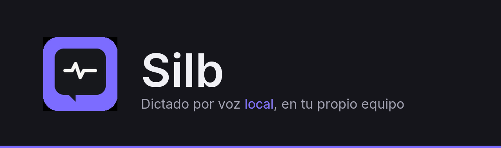
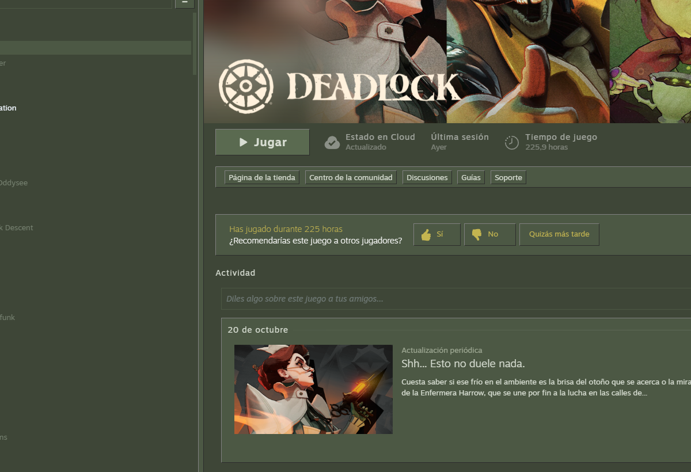
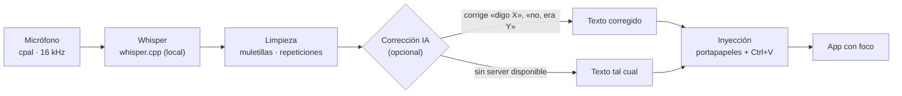

<div align="center">



**Dictado por voz local y de escritorio nativo. Alternativa open-source al flujo de Wispr Flow.**

[](LICENSE)
[](https://www.rust-lang.org/)
[](#compilar-desde-el-código)
[](https://github.com/ggerganov/whisper.cpp)
[](#tests)

[Instalar](#instalar) · [Compilar](#compilar-desde-el-código) · [Uso](#uso) · [Configuración](#configuración-avanzada-configjson) · [Contribuir](#contribuir)

</div>

---

Hablas, sueltas el atajo y el texto se escribe donde esté tu cursor. **Todo el
procesamiento es local**: la transcripción corre en tu máquina con whisper.cpp
y nada sale de ella. La única parte opcional que usa red es la corrección IA
si eliges un proveedor Cloud.

## Características

- **UI nativa**: Iced (renderizado directo, sin webview, sin HTML/CSS/JS).
- **Transcripción local**: whisper.cpp vía `whisper-rs` (modelos GGML,
  tiny/base/small). Nada sale de tu máquina.
- **Atajo global** Ctrl+Shift+D (configurable en `config.json` → `shortcut`):
  pulsa para grabar, suelta para transcribir.
- **Inyección en la app activa**: al terminar, el texto se escribe en la
  ventana con foco (Slack, Notion, editor…) vía portapapeles + Ctrl+V.
  Formato (pegar/teclear), retardo y filtro por título de ventana
  configurables. Si no hay ninguna ventana con foco, el texto queda copiado
  en el portapapeles con aviso (nunca se pierde).
- **Nota editable**: el transcript se puede corregir a mano antes de mandarla —
  un error de Whisper ya no obliga a re-dictar. Editar y seguir dictando no se
  pisan; «Copiar» se confirma con un «✓ Copiado» breve y borrar la nota pide
  confirmación y se puede deshacer.
- **Post-procesado local**: normalización de repeticiones y expresiones de
  relleno antes de la inyección; las muletillas (inequívocas, solo antes de
  pausa, solo al inicio) son configurables desde Ajustes → Muletillas y se
  pueden desactivar por completo.
- **Corrección IA** (opcional, sin levantar nada a mano): un LLM revisa tu
  dictado y arregla las auto-correcciones habladas («que calor en murcia
  **digo cartagena**» → «que calor en cartagena») y las correcciones
  cross-turn («no no lo último está mal, es 2 en vez de 4»). Local por
  defecto (llama.cpp, sin internet), con proveedores alternativos Custom
  (cualquier endpoint OpenAI-compatible) y Cloud (OpenAI). Documentado en
  [`docs/CORRECCION-VOZ.md`](docs/CORRECCION-VOZ.md) (diseño) y
  [`docs/SETUP.md`](docs/SETUP.md) (configuración).
- **Diccionario personal** (jerga, siglas, nombres propios) persistente.
- **Rectificaciones habladas**: «no, quería decir X» corrige el último turno.
- **Robustez de escritorio**: una segunda instancia no roba el atajo (guard
  de instancia única con aviso), un micrófono que muere a mitad de grabación
  corta el turno y transcribe lo oído, y un modelo de voz truncado se
  re-descarga solo.
- **Bandeja del sistema y burbuja flotante**: minimiza a la bandeja, burbuja
  arrastrable con animación por frames, tema claro/oscuro automático.

## Capturas

<p align="center">
  
  &nbsp;&nbsp;&nbsp;&nbsp;
  
</p>

Ventana principal y burbuja flotante con el **tema por defecto** (claro/oscuro
automático). Desde Ajustes puedes cambiar la paleta, poner tu propia imagen de
fondo y animar la burbuja por frames.

## Cómo funciona



El recorrido completo de una frase, fichero por fichero, está en
[`docs/ARQUITECTURA.md`](docs/ARQUITECTURA.md).

## Instalar

- **Instalador** (recomendado): `silb-X.Y.Z-setup.exe` desde la página
  de [Releases](https://github.com/JuanFrancisco-Mateo/whispr-open/releases).
  Instala en `%LOCALAPPDATA%\Programs\Silb` **sin permisos de
  administrador**, con acceso directo, entrada en «Agregar o quitar programas»
  y desinstalador.
- **Portable**: el propio `silb.exe` autocontenido, sin instalación.
- **¿Aún no hay releases publicadas?** Compílalo en unos minutos (ver abajo).

Detalles de empaquetado, tamaños medidos y firma en
[`docs/EMPAQUETADO.md`](docs/EMPAQUETADO.md).

## Compilar desde el código

**Requisitos** (solo para compilar):

- **Windows 10/11**: Rust con toolchain MSVC (`rustup default stable-msvc`),
  Visual Studio Build Tools con **MSVC** y **CMake** — whisper-rs compila
  whisper.cpp en C desde el primer build.
- **Linux**: Rust estable, `cmake` y las librerías de desarrollo de ALSA,
  Wayland/XKB y GTK 3 (en Arch: `alsa-lib cmake clang`; en Debian/Ubuntu:
  `libasound2-dev libxkbcommon-dev libwayland-dev libgtk-3-dev cmake clang`).
  Build: `scripts/build-linux.sh` (binario `target/release/silb`), lanzar con
  `scripts/run-linux.sh`.

Eso es todo para el build **CPU** (el de por defecto): no hace falta toolkit
CUDA ni GPU.

**Build CUDA (opcional).** Solo si quieres que whisper.cpp transcriba en la
GPU: instala el toolkit CUDA (con `CUDA_PATH` definido) y compila con la
feature:

```powershell
cargo build --release --features cuda
```

Qué gana y qué pierde:

- **CPU**: compila en cualquier Windows 10/11 con MSVC + CMake; transcripción
  más lenta (el modelo `small` va por debajo del tiempo real en un Ryzen
  moderno, pero suficiente para dictar).
- **CUDA**: transcripción en tiempo real con GPU NVIDIA; exige driver +
  toolkit en la máquina de compilación y un binario que asume GPU.

```powershell
git clone https://github.com/JuanFrancisco-Mateo/whispr-open.git
cd whispr-open
git checkout native-iced        # rama activa (main es el legado web)
cargo run --release
```

La primera compilación tarda 5–10 min (iced + whisper.cpp). El binario queda
en `target\release\silb.exe` y **no necesita nada instalado para
ejecutarse**.

> **Nota para WSL**: para un binario **Linux** compila dentro de WSL
> (`cargo build --release`) con las librerías de desarrollo del apartado de
> requisitos; para el `.exe` usa el cargo de Windows desde `cmd.exe`.

### Primer arranque

1. La app abre con la **pantalla de carga** y hace todo sola: descarga el
   modelo de voz (con progreso) si falta y lo precarga, y lanza el server LLM
   local si la corrección IA está activada y el endpoint no responde.
2. El chip de estado (visible siempre en la ventana principal) te dice si la
   corrección IA está lista: `● Corrección IA: activa · <modelo>` (verde),
   `○ … inactiva — <motivo>` (ámbar: dictar funciona igual, sin corregir) o
   `○ … apagada` (gris: actívala en Ajustes).
3. Pulsa **Ctrl+Shift+D** (o el botón ● Grabar) y habla. Al soltar, el texto
   se transcribe y se escribe en la app con foco.

La **corrección IA local es opcional**: solo si quieres el corrector «de
fábrica» necesitas `llama-server.exe` y un modelo GGUF (ver
[`docs/SETUP.md`](docs/SETUP.md)). La app **autodetecta** el server y el
modelo; si no los encuentra, la corrección se desactiva con un aviso y el
dictado sigue funcionando.

## Uso

### Guía rápida

1. Arranca la app. La primera vez que dictes con un modelo, se descarga solo
   (~75 MB tiny / ~142 MB base / ~466 MB small) a
   `%APPDATA%\whispr-open\models`.
2. Pulsa **Ctrl+Shift+D** (o el botón ● Grabar), habla, y vuelve a pulsar para
   transcribir.
3. Si «Autoinyectar» está activo, el texto se escribe en la app que tenga el
   foco. Si no, lo verás en la ventana y puedes usar «Escribir en app» /
   «Copiar».
4. En Configuración: modelo de Whisper, apariencia, corrección IA y
   diccionario.

La guía sin jerga técnica está en
[`docs/GUIA-USUARIO.md`](docs/GUIA-USUARIO.md).

### Opciones explicadas (mismo texto que la UI)

**Corrección IA** (primer nivel de Ajustes):

- *Corrección IA*: «Una IA revisa y corrige lo que dictas» — «Al terminar un
  turno, la IA lo revisa y corrige («digo X», «no, era Y»…). Si el servidor de
  IA no está disponible, el dictado se inserta entero, sin corregir.»
- *Proveedor*: «Quién corrige lo que dictas: Local — llama.cpp, el que viene
  con la app (sin internet, recomendado) · Custom LLM — tu propio endpoint
  OpenAI-compatible · Cloud — OpenAI. Por defecto: Local.»
- *Endpoint LLM*: «Dirección del servidor de IA (API compatible con OpenAI).
  Local: http://127.0.0.1:8081/v1.»
- *Modelo IA*: «El modelo que corrige. Debe estar en tu servidor local o ser
  uno de los que ofrece la nube.»
- *API key* (solo Custom/Cloud): «Clave del endpoint si la exige (Custom:
  opcional · Cloud: obligatoria). Se guarda en el Administrador de credenciales
  de Windows, nunca en la config.»
- *Server LLM*: «Ejecutable llama-server.exe que la app lanza al arrancar.
  Vacío = autodetección. Solo indícalo aquí si la app no lo encuentra sola.»

**Ajustes avanzados** (técnico, colapsado por defecto):

- *Calidad de transcripción (beam size)*, rango 1–8, recomendado 5: «Calidad de
  transcripción (beam size) vs velocidad: 1 = la más rápida, 8 = la más fiel.»
- *Núcleos de CPU*, rango 1–16, recomendado 4: «Núcleos de CPU que usa Whisper
  al transcribir. Sube si el equipo va justo de velocidad; baja para dejar
  recursos al resto.»
- *Espera máx. (s)* del corrector, rango 1–120, recomendado 25: «Espera máxima
  de la IA antes de dar el turno por definitivo: si lo supera, se inserta sin
  corregir.»
- *Sensibilidad* del clasificador (0–100, default 50): subirla = más
  conservador (menos llamadas al LLM, más dictado normal por defecto).

Modelo de transcripción: `es` por defecto (los modelos base de whisper.cpp son
multilingües; el idioma se puede cambiar a `auto`, `es`, `en`, `fr`, `de`, `it`
o `pt` desde Ajustes). El audio se entrega siempre a Whisper en 16 kHz.

## Configuración avanzada (`%APPDATA%\whispr-open\config.json`)

Además de lo que se ajusta desde la UI (Ajustes), el archivo de configuración
permite:

| Clave | Valores | Default |
|---|---|---|
| `shortcut` | atajo global de dictado: `"Ctrl+Shift+D"`, `"Alt+Space"`, `"Ctrl+Alt+F12"`, `"Ctrl+Shift+K"`… | `"Ctrl+Shift+D"` |
| `inject_format` | `"paste"` (portapapeles + Ctrl+V) o `"type"` (tecleo directo, sin tocar el portapapeles) | `"paste"` |
| `inject_delay_ms` | retardo en ms antes de pegar/teclear (`0` = sin retardo) | `40` |
| `inject_window_filter` | solo inyecta si el título de la ventana activa lo contiene (substring, sin distinguir mayúsculas) | (sin filtro: cualquier app) |
| `correction_provider` | `"default"` (Local, llama.cpp — el que viene con la app), `"cloud"` (OpenAI) o `"custom"` (endpoint OpenAI-compatible) | `"default"` |
| `llm_base_url` | endpoint OpenAI-compatible (Cambiar de proveedor usa el mismo campo) | local `http://127.0.0.1:8081/v1` |
| `llm_model` | identificador del modelo corrector | `ornith-1.0-9b` |
| `llm_timeout_secs` | timeout de la corrección HTTP | `25` |
| `llm_classifier_threshold` | sensibilidad del clasificador 0–100 (subir = más conservador; 0 = pasivo) | `50` |
| `ai_correction_confirm` | `true` = mostrar «Aplicar / Descartar» antes de aplicar la corrección | `false` |
| `llama_server_path` | ruta del `llama-server.exe` local (vacío = autodetección) | (autodetección) |
| `beam_size` | calidad de transcripción de whisper, 1–8 (1 = rápida, 8 = fiel) | `5` |
| `n_threads` | núcleos del decoder de whisper, 1–16 | `4` |

La **API key no se guarda en texto plano en `config.json`**: en Windows se
almacena en el **Credential Manager** (target `WhisprOpen/llm-api-key`) y se
reutilizan las configuraciones antiguas durante la migración.

Los valores inválidos o ausentes se ignoran con el default: la config nunca
rompe el arranque, y el atajo real registrado se muestra en la UI (Ajustes).

## Estructura

| Fichero | Contenido |
|---|---|
| `src/main.rs` | entrada Iced + guard de instancia única |
| `src/app.rs` | UI + flujo de dictado + nota editable + routing del corrector IA + ciclo de vida del server |
| `src/ui/*.rs` | secciones de la ventana: ajustes, pestañas, grabación, eventos de burbuja y bandeja |
| `src/domain/*.rs` | lógica pura (limpieza fija, corrección, diccionario) |
| `src/domain/corrective.rs` | clasificadores (cross-turn e in-turn) + diff — sin I/O |
| `src/llm.rs` | cliente LLM OpenAI-compatible (ureq), prompts, guard anti-truncación, server nativo |
| `src/audio.rs` | captura de micrófono (cpal) |
| `src/transcribe.rs` | modelos + whisper.cpp + descarga robusta |
| `src/inject.rs` | escritura en app activa |
| `src/hotkey.rs` | atajo global |
| `src/single_instance.rs` | guard de instancia única (mutex de Windows) |
| `src/config.rs` | configuración persistente + Credential Manager |
| `src/theme.rs` | tokens de diseño + contraste WCAG medido |
| `src/bubble.rs` · `src/tray.rs` · `src/fonts.rs` · `src/log.rs` | burbuja flotante, bandeja, fuente emoji, log a archivo |
| `src/custom_image.rs` | imagen de fondo propia y sprite/animación por frames en la burbuja |
| `docs/CORRECCION-VOZ.md` | especificación y diseño final del corrector IA |
| `docs/GUIA-USUARIO.md` | guía de usuario: dictar y corregir hablando |
| `docs/ARQUITECTURA.md` | recorrido del código para alguien que nunca ha tocado Rust |
| `docs/SETUP.md` | cómo configurar Local / Custom / Cloud |
| `docs/EMPAQUETADO.md` · [`docs/ROADMAP.md`](docs/ROADMAP.md) · `docs/UI-FUTURA.md` | empaquetado, hoja de ruta y mejoras de UI |
| `docs/ROADMAP-LEGADO-WEB.md` | hoja de ruta de la versión web (histórico, rama `main`) |

## Tests

```powershell
cargo test   # 336 passed, 0 failed, 3 ignored (dominio, config, audio, burbuja, UI, llm, robustez)
cargo check  # sin errores
```

## Contribuir

Las contribuciones son bienvenidas. Antes de empezar, lee
[`CONTRIBUTING.md`](CONTRIBUTING.md): cómo reportar bugs, pedir funciones y
enviar pull requests, el estilo del proyecto (commits en español, tests
verdes) y qué rama tocar.

- 🐛 [Reportar un bug](https://github.com/JuanFrancisco-Mateo/whispr-open/issues/new?template=bug.yml)
- 💡 [Pedir una función](https://github.com/JuanFrancisco-Mateo/whispr-open/issues/new?template=feature.yml)
- 🗺️ Qué queda por hacer: [`docs/ROADMAP.md`](docs/ROADMAP.md) y
  [`docs/UI-FUTURA.md`](docs/UI-FUTURA.md)

Desde la **0.5.0** el port a Linux está integrado en `native-iced`: compila y
arranca en Wayland (Hyprland) y X11. Lo que cambia por plataforma está en
[`docs/PORT-LINUX/`](docs/PORT-LINUX/) (dependencias, atajo en Hyprland,
backend de inyección y límites conocidos). En Linux no hay bandeja del sistema
ni instalador.

## Roadmap

La hoja de ruta viva es [`docs/ROADMAP.md`](docs/ROADMAP.md). Resumen: la
0.4.0 cerró el producto para Windows (instalador, icono, personalización
completa) y la 0.5.0 integra el port a Linux; lo pendiente se agrupa en
[`docs/UI-FUTURA.md`](docs/UI-FUTURA.md).

## Otros proyectos

Más cosas mías en [github.com/JuanFrancisco-Mateo](https://github.com/JuanFrancisco-Mateo):

- [**timer-app**](https://github.com/JuanFrancisco-Mateo/timer-app) — cronómetro web en HTML, CSS y JavaScript.
- [**TicTacToeTresEnRaya**](https://github.com/JuanFrancisco-Mateo/TicTacToeTresEnRaya) — interfaz de tres en raya con JavaFX.
- [**proyecto_TFG**](https://github.com/JuanFrancisco-Mateo/proyecto_TFG) — Trabajo de Fin de Grado (Java).
- [**TareaRA01_AccesoDatos**](https://github.com/JuanFrancisco-Mateo/TareaRA01_AccesoDatos) · [**TareaRA02_AccesoDatos**](https://github.com/JuanFrancisco-Mateo/TareaRA02_AccesoDatos) — ejercicios de Acceso a Datos (Java).
- 🌐 [Portfolio interactivo](https://juanfrancisco-porfolio-interactivo.vercel.app/) · [El baúl del gato](https://el-baul-del-gato.vercel.app/)

## Historial de versiones

- **0.3.0** (rama `native-iced`): cierre del producto (fases R6+R7) — instalador
  Inno Setup que instala/desinstala con el registro de programas correcto, icono
  multirresolución (16/24/32/48/64/128/256) incrustado en el `.exe`, y
  Personalización I+II+III dentro del binario release (Ajustes por secciones,
  paleta editable con presets y por campo, imágenes y animación por frames en la
  burbuja). Añade la documentación de cierre (`INFORME-CIERRE.md`).
- **0.2.0** (rama `native-iced`): reescritura a escritorio nativo. Adiós web.
  Cierre de la documentación (fase R5) — licencia MIT,
  `docs/ARQUITECTURA.md` para quien llega nuevo, guía de usuario ampliada,
  doc-comments en español en todas las funciones y tipos públicos. Robustez a
  prueba de fallos (descarga, audio, inyección, instancia única), nota editable,
  contraste AA medido, y corrección IA completa — server LLM nativo
  autogestionado, guard anti-truncación, proveedores Local/Custom/Cloud con API
  key en Credential Manager.
- **0.1.0** (rama `main`): prototipo web (React + Tauri v2 + Whisper WASM), 40 tests.

## Licencia

[MIT](LICENSE) — uso, modificación y redistribución libres. Copyright (c) 2026
Whispr Open contributors.
