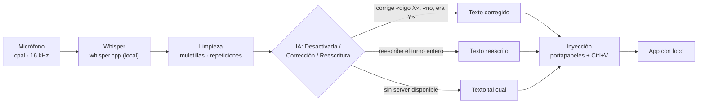

<div align="center">


**Dictado por voz en tu propio equipo, con una app de escritorio de verdad. Alternativa open-source al flujo de Wispr Flow.**

[](LICENSE)
[](https://www.rust-lang.org/)
[](#compilar-desde-el-código)
[](https://github.com/ggerganov/whisper.cpp)
[](#tests)

[Instalar](#instalar) · [Compilar](#compilar-desde-el-código) · [Uso](#uso) · [Configuración](#configuración-avanzada-configjson) · [Contribuir](#contribuir)

</div>

---

Hablas, sueltas el atajo y el texto aparece escrito donde tengas el cursor. **Todo
el proceso ocurre en tu ordenador**: la transcripción la hace whisper.cpp en tu
máquina y nada sale de ella. La única parte opcional que usa internet es la
corrección con IA, y solo si eliges un proveedor en la nube.

## Características

- **Interfaz propia**: dibujada directamente con Iced, sin navegador incrustado
  ni HTML/CSS/JS.
- **Transcripción en tu equipo**: whisper.cpp a través de `whisper-rs` (modelos
  GGML: tiny, base y small). Nada sale de tu máquina.
- **Atajo que funciona en cualquier app** Ctrl+Shift+D (se cambia en
  `config.json` → `shortcut`): pulsas para grabar y sueltas para transcribir.
- **El texto se escribe en la app que tengas delante**: al terminar, el texto se
  pega en la ventana con el foco (Slack, Notion, tu editor…) copiándolo al
  portapapeles y pulsando Ctrl+V. Puedes elegir si se pega o se teclea, cuánto
  espera antes de hacerlo y limitarlo por el título de la ventana. Si no hay
  ninguna ventana con el foco, el texto se queda copiado en el portapapeles con
  un aviso (nunca se pierde).
- **Nota editable**: puedes corregir a mano lo transcrito antes de enviarlo, así
  que un fallo de Whisper ya no te obliga a dictar otra vez. Editar y seguir
  dictando no se pisan; «Copiar» se confirma con un «✓ Copiado» breve, y borrar
  la nota pide confirmación y se puede deshacer.
- **Limpieza del texto en tu equipo**: quita repeticiones y muletillas antes de
  escribir el texto. Qué muletillas se quitan (las que no dejan duda, las que
  solo salen antes de una pausa, las del principio) se elige en Ajustes →
  Muletillas, y se pueden desactivar del todo.
- **Corrección con IA** (opcional, sin arrancar nada a mano), con tres modos:
  *Desactivada* (el dictado se escribe tal cual), *Corrección* (la IA arregla
  las correcciones que dices en voz alta — «que calor en murcia **digo
  cartagena**» → «que calor en cartagena» — y las que se refieren al turno
  anterior — «no no lo último está mal, es 2 en vez de 4») y *Reescritura* (la IA
  reescribe el turno entero: limpio, puntuado y sin muletillas ni
  auto-correcciones; para este modo se recomienda el modelo
  **Qwen3-4B-Instruct-2507**, ~2,4 GB). Por defecto funciona en tu equipo
  (llama.cpp, sin internet), y también puedes usar un proveedor propio Custom
  (cualquier servidor compatible con OpenAI) o la nube (OpenAI).
  Está explicado en [`docs/CORRECCION-VOZ.md`](docs/CORRECCION-VOZ.md) (cómo
  está diseñado) y [`docs/SETUP.md`](docs/SETUP.md) (cómo se configura).
- **Diccionario personal** (jerga, siglas, nombres propios) que se guarda entre
  sesiones.
- **Rectificaciones habladas**: «no, quería decir X» corrige lo último que
  dictaste.
- **Aguanta los tropezones del día a día**: si abres la app dos veces, la
  segunda no le roba el atajo a la primera (avisa y se cierra); si el micrófono
  se cae a mitad de grabación, el turno se corta y se transcribe lo que se oyó;
  y si un modelo de voz llega incompleto, se vuelve a descargar solo.
- **Icono junto al reloj y burbuja flotante**: puedes minimizar a la bandeja,
  arrastrar una burbuja que se mueve por frames y usar tema claro u oscuro
  automático.

## Capturas

<p align="center">
  
  &nbsp;&nbsp;&nbsp;&nbsp;
  
</p>

Ventana principal y burbuja flotante con el **tema por defecto** (claro u oscuro
automático). Desde Ajustes puedes cambiar los colores, poner tu propia imagen de
fondo y animar la burbuja por frames.

## Cómo funciona



El recorrido completo de una frase, fichero por fichero, está en
[`docs/ARQUITECTURA.md`](docs/ARQUITECTURA.md).

## Instalar

- **Instalador** (lo recomendado): `silb-X.Y.Z-setup.exe` desde la página
  de [Releases](https://github.com/JuanFrancisco-Mateo/silb/releases).
  Instala en `%LOCALAPPDATA%\Programs\Silb` **sin pedir permisos de
  administrador**, con acceso directo, entrada en «Agregar o quitar programas»
  y desinstalador.
- **Portable**: el propio `silb.exe`, que lleva todo dentro y no hay que
  instalar.
- **¿Todavía no hay releases publicadas?** Compílalo tú, son unos minutos (ver
  abajo).

Los detalles del empaquetado, los tamaños medidos y la firma están en
[`docs/EMPAQUETADO.md`](docs/EMPAQUETADO.md).

## Compilar desde el código

**Requisitos** (solo para compilar):

- **Windows 10/11**: Rust con la herramienta de compilación MSVC
  (`rustup default stable-msvc`) y Visual Studio Build Tools con **MSVC** y
  **CMake** — whisper-rs compila whisper.cpp, que está en C, en la primera
  compilación.
- **Linux**: Rust estable, `cmake` y las librerías de desarrollo de ALSA,
  Wayland/XKB y GTK 3 (en Arch: `alsa-lib cmake clang`; en Debian/Ubuntu:
  `libasound2-dev libxkbcommon-dev libwayland-dev libgtk-3-dev cmake clang`).
  Compila con `scripts/build-linux.sh` (el binario sale en
  `target/release/silb`) y lánzalo con `scripts/run-linux.sh`.

Con eso basta para la compilación **de CPU** (la de por defecto): no hace falta
nada de CUDA ni tener una GPU.

**Compilación con CUDA (opcional).** Solo si quieres que whisper.cpp transcriba
en la GPU: instala el kit de CUDA (con `CUDA_PATH` definido) y compila con la
opción:

```powershell
cargo build --release --features cuda
```

Qué ganas y qué pierdes:

- **CPU**: compila en cualquier Windows 10/11 con MSVC y CMake; transcribir es
  más lento (el modelo `small` va por debajo del tiempo real en un Ryzen
  moderno, pero da de sobra para dictar).
- **CUDA**: transcripción en tiempo real con una GPU NVIDIA; exige driver y kit
  de CUDA en el equipo donde compilas, y el binario da por hecho que hay GPU.

```powershell
git clone https://github.com/JuanFrancisco-Mateo/silb.git
cd whispr-open
git checkout native-iced        # rama activa (main es el legado web)
cargo run --release
```

La primera compilación tarda 5–10 min (iced + whisper.cpp). El binario queda
en `target\release\silb.exe` y **no necesita nada instalado para
funcionar**.

> **Nota para WSL**: si quieres un binario **para Linux**, compila dentro de WSL
> (`cargo build --release`) con las librerías de desarrollo del apartado de
> requisitos; para el `.exe` usa el cargo de Windows desde `cmd.exe`.

### Primer arranque

1. La app abre con la **pantalla de carga** y lo hace todo sola: descarga el
   modelo de voz (con barra de progreso) si falta y lo deja preparado, y arranca
   el servidor de IA local si la corrección está activada y el servidor no
   responde.
2. El aviso de estado (siempre visible en la ventana principal) te dice si la
   corrección con IA está lista: `● Corrección IA: activa · <modelo>` (verde),
   `○ … inactiva — <motivo>` (ámbar: puedes dictar igual, sin corregir) o
   `○ … apagada` (gris: actívala en Ajustes).
3. Pulsa **Ctrl+Shift+D** (o el botón ● Grabar) y habla. Al soltar, el texto se
   transcribe y se escribe en la app que tenga el foco.

La **corrección con IA local es opcional**: el servidor (`llama-server.exe`)
viaja con la app y el **modelo se elige y se descarga desde Ajustes** (lista de
modelos probados, con Qwen3-4B para el modo Reescritura, o un repo/URL de
Hugging Face en «Otro»; ver
[`docs/SETUP.md`](docs/SETUP.md)). Si no hay modelo, la corrección se desactiva
con un aviso y el dictado sigue funcionando.

## Uso

### Guía rápida

1. Arranca la app. La primera vez que dictes con un modelo, se descarga solo
   (~75 MB tiny / ~142 MB base / ~466 MB small) en
   `%APPDATA%\whispr-open\models`.
2. Pulsa **Ctrl+Shift+D** (o el botón ● Grabar), habla, y vuelve a pulsar para
   transcribir.
3. Si «Autoinyectar» está activo, el texto se escribe en la app que tenga el
   foco. Si no, lo verás en la ventana y puedes usar «Escribir en app» /
   «Copiar».
4. En Configuración: modelo de Whisper, aspecto, corrección con IA y
   diccionario.

La guía sin palabras técnicas está en
[`docs/GUIA-USUARIO.md`](docs/GUIA-USUARIO.md).

### Opciones explicadas (mismo texto que la UI)

**Corrección IA** (primer nivel de Ajustes):

- *Modo de IA*: selector de tres — **Desactivada** («El dictado se escribe tal
  cual»), **Corrección** («La IA arregla las auto-correcciones («digo X»). Solo
  actúa cuando las detecta») y **Reescritura** («La IA reescribe el turno entero,
  limpio y puntuado. Tarda algo más en cada dictado»). Con Desactivada o
  Corrección no se llama al modelo si no hay nada que corregir; con Reescritura
  se llama en cada turno. Si el servidor de IA no está disponible, el dictado se
  inserta entero, sin corregir.
- *Proveedor*: «Quién corrige lo que dictas: Local — llama.cpp, el que viene
  con la app (sin internet, recomendado) · Custom LLM — tu propio endpoint
  OpenAI-compatible · Cloud — OpenAI. Por defecto: Local.»
- *Endpoint LLM*: «Dirección del servidor de IA (API compatible con OpenAI).
  Local: http://127.0.0.1:8081/v1.»
- *Modelo IA local* (proveedor Local): desplegable con los modelos probados
  (Qwen2.5-0.5B ~491 MB, el recomendado para corregir · Llama 3.2 1B ~808 MB ·
  Qwen2.5-1.5B ~1,1 GB · **Qwen3-4B-Instruct-2507 ~2,4 GB, el mejor para
  reescribir**) y «Otro (repo o URL de Hugging Face)…» para pegar `owner/repo` o
  la dirección de un `.gguf`. Si el fichero no está en el disco, el bloque enseña
  **Descargar** y lo baja a `models-llm/` con progreso.
- *Modelo IA* (solo Custom/Cloud): «El modelo que corrige en la nube.»
- *API key* (solo Custom/Cloud): «Clave del endpoint si la exige (Custom:
  opcional · Cloud: obligatoria). Se guarda en el Administrador de credenciales
  de Windows, nunca en la config.»
- *Server LLM*: «Ejecutable llama-server.exe que la app lanza al arrancar.
  Vacío = autodetección. Solo indícalo aquí si la app no lo encuentra sola.»

**Ajustes avanzados** (para quien quiera afinar, plegados por defecto):

- *Calidad de transcripción (beam size)*, rango 1–8, recomendado 5: «Calidad de
  transcripción (beam size) vs velocidad: 1 = la más rápida, 8 = la más fiel.»
- *Núcleos de CPU*, rango 1–16, recomendado 4: «Núcleos de CPU que usa Whisper
  al transcribir. Sube si el equipo va justo de velocidad; baja para dejar
  recursos al resto.»
- *Espera máx. (s)* del corrector, rango 1–120, recomendado 25: «Espera máxima
  de la IA antes de dar el turno por definitivo: si lo supera, se inserta sin
  corregir.»
- *Sensibilidad* del clasificador (0–100, por defecto 50): si la subes, la app
  se vuelve más prudente (consulta menos a la IA y deja más dictado normal).

Modelo de transcripción: `es` por defecto (los modelos base de whisper.cpp son
multilingües; el idioma se puede cambiar a `auto`, `es`, `en`, `fr`, `de`, `it`
o `pt` desde Ajustes). El audio se entrega siempre a Whisper a 16 kHz.

## Configuración avanzada (`%APPDATA%\whispr-open\config.json`)

Además de lo que se ajusta desde la app (Ajustes), el archivo de configuración
permite:

| Clave | Valores | Default |
|---|---|---|
| `shortcut` | atajo global de dictado: `"Ctrl+Shift+D"`, `"Alt+Space"`, `"Ctrl+Alt+F12"`, `"Ctrl+Shift+K"`… | `"Ctrl+Shift+D"` |
| `inject_format` | `"paste"` (portapapeles + Ctrl+V) o `"type"` (tecleo directo, sin tocar el portapapeles) | `"paste"` |
| `inject_delay_ms` | retardo en ms antes de pegar/teclear (`0` = sin retardo) | `40` |
| `inject_window_filter` | solo inyecta si el título de la ventana activa lo contiene (substring, sin distinguir mayúsculas) | (sin filtro: cualquier app) |
| `correction_provider` | `"default"` (Local, llama.cpp — el que viene con la app), `"cloud"` (OpenAI) o `"custom"` (endpoint OpenAI-compatible) | `"default"` |
| `llm_base_url` | endpoint OpenAI-compatible (Cambiar de proveedor usa el mismo campo) | local `http://127.0.0.1:8081/v1` |
| `llm_model` | identificador del modelo corrector | `ornith-1.0-9b` |
| `llm_timeout_secs` | tiempo máximo de espera de la corrección por HTTP | `25` |
| `llm_classifier_threshold` | sensibilidad del clasificador 0–100 (subir = más conservador; 0 = pasivo) | `50` |
| `ai_correction_confirm` | `true` = mostrar «Aplicar / Descartar» antes de aplicar la corrección | `false` |
| `llama_server_path` | ruta del `llama-server.exe` local (vacío = autodetección) | (autodetección) |
| `beam_size` | calidad de transcripción de whisper, 1–8 (1 = rápida, 8 = fiel) | `5` |
| `n_threads` | núcleos del decoder de whisper, 1–16 | `4` |

La **API key no se guarda tal cual en `config.json`**: en Windows se guarda en
el **Administrador de credenciales** (con el nombre `WhisprOpen/llm-api-key`) y,
al migrar, se reaprovechan las configuraciones antiguas.

Los valores que no valen o no están se ignoran y se usa el valor por defecto: la
configuración nunca impide que la app arranque, y el atajo que realmente se ha
registrado se muestra en la app (Ajustes).

## Estructura

| Fichero | Contenido |
|---|---|
| `src/main.rs` | entrada Iced + guard de instancia única |
| `src/app.rs` | UI + flujo de dictado + nota editable + routing del corrector IA + ciclo de vida del server |
| `src/ui/*.rs` | secciones de la ventana: ajustes, pestañas, grabación, eventos de burbuja y bandeja |
| `src/domain/*.rs` | lógica pura (limpieza fija, corrección, diccionario) |
| `src/domain/corrective.rs` | clasificadores (cross-turn e in-turn) + diff — sin I/O |
| `src/llm.rs` | cliente LLM OpenAI-compatible (ureq), prompts, guard anti-truncación, server nativo |
| `src/audio.rs` | captura de micrófono (cpal) |
| `src/transcribe.rs` | modelos + whisper.cpp + descarga robusta |
| `src/inject.rs` | escritura en app activa |
| `src/hotkey.rs` | atajo global |
| `src/single_instance.rs` | guard de instancia única (mutex de Windows) |
| `src/config.rs` | configuración persistente + Credential Manager |
| `src/theme.rs` | tokens de diseño + contraste WCAG medido |
| `src/bubble.rs` · `src/tray.rs` · `src/fonts.rs` · `src/log.rs` | burbuja flotante, bandeja, fuente emoji, log a archivo |
| `src/custom_image.rs` | imagen de fondo propia y sprite/animación por frames en la burbuja |
| `docs/CORRECCION-VOZ.md` | especificación y diseño final del corrector IA |
| `docs/GUIA-USUARIO.md` | guía de usuario: dictar y corregir hablando |
| `docs/ARQUITECTURA.md` | recorrido del código para alguien que nunca ha tocado Rust |
| `docs/SETUP.md` | cómo configurar Local / Custom / Cloud |
| `docs/EMPAQUETADO.md` · [`docs/ROADMAP.md`](docs/ROADMAP.md) · `docs/UI-FUTURA.md` | empaquetado, hoja de ruta y mejoras de UI |

## Tests

```powershell
cargo test   # 352 passed, 0 failed, 1 ignored (dominio, config, audio, burbuja, UI, llm, robustez)
cargo check  # sin errores
```

## Contribuir

Las contribuciones son bienvenidas. Antes de empezar, lee
[`CONTRIBUTING.md`](CONTRIBUTING.md): cómo avisar de un fallo, pedir una función
y enviar cambios, el estilo del proyecto (commits en español, tests en verde) y
qué rama tocar.

- 🐛 [Avisar de un fallo](https://github.com/JuanFrancisco-Mateo/silb/issues/new?template=bug.yml)
- 💡 [Pedir una función](https://github.com/JuanFrancisco-Mateo/silb/issues/new?template=feature.yml)
- 🗺️ Qué queda por hacer: [`docs/ROADMAP.md`](docs/ROADMAP.md) y
  [`docs/UI-FUTURA.md`](docs/UI-FUTURA.md)

El port a Linux va incluido: compila y arranca
en Wayland (Hyprland) y en X11. Lo que cambia según el sistema está en
[`docs/PORT-LINUX/`](docs/PORT-LINUX/) (dependencias, atajo en Hyprland, cómo se
escribe el texto y límites conocidos). En Linux no hay icono junto al reloj ni
instalador.

## Roadmap

La hoja de ruta al día es [`docs/ROADMAP.md`](docs/ROADMAP.md). En resumen: la
0.4.0 terminó el producto para Windows (instalador, icono, personalización
completa) y la 0.5.0 mete el port a Linux; lo que falta está agrupado en
[`docs/UI-FUTURA.md`](docs/UI-FUTURA.md).

## Otros proyectos

Más cosas mías en [github.com/JuanFrancisco-Mateo](https://github.com/JuanFrancisco-Mateo):

- [**timer-app**](https://github.com/JuanFrancisco-Mateo/timer-app) — cronómetro web en HTML, CSS y JavaScript.
- [**TicTacToeTresEnRaya**](https://github.com/JuanFrancisco-Mateo/TicTacToeTresEnRaya) — interfaz de tres en raya con JavaFX.
- [**proyecto_TFG**](https://github.com/JuanFrancisco-Mateo/proyecto_TFG) — Trabajo de Fin de Grado (Java).
- [**TareaRA01_AccesoDatos**](https://github.com/JuanFrancisco-Mateo/TareaRA01_AccesoDatos) · [**TareaRA02_AccesoDatos**](https://github.com/JuanFrancisco-Mateo/TareaRA02_AccesoDatos) — ejercicios de Acceso a Datos (Java).
- 🌐 [Portfolio interactivo](https://juanfrancisco-porfolio-interactivo.vercel.app/) · [El baúl del gato](https://el-baul-del-gato.vercel.app/)

## Historial de versiones

- **0.3.0** (rama `native-iced`): cierre del producto (fases R6+R7) — instalador
  Inno Setup que instala y desinstala dejando bien el registro de programas,
  icono en varios tamaños (16/24/32/48/64/128/256) metido dentro del `.exe`, y
  la Personalización I+II+III ya en el binario release (Ajustes por secciones,
  colores editables con presets o campo a campo, imágenes y animación por frames
  en la burbuja). Añade la documentación de cierre en `docs/`.
- **0.2.0** (rama `native-iced`): reescritura a escritorio nativo. Adiós web.
  Cierre de la documentación (fase R5) — licencia MIT,
  `docs/ARQUITECTURA.md` para quien llega nuevo, guía de usuario ampliada y
  comentarios de documentación en español en todas las funciones y tipos
  públicos. Resistencia a fallos (descarga, audio, escritura del texto,
  instancia única), nota editable, contraste AA medido y la corrección con IA
  completa — el servidor de IA lo arranca y apaga la propia app, protección
  contra respuestas recortadas, y proveedores Local/Custom/Cloud con la API key
  en el Administrador de credenciales.
- **0.1.0** (rama `main`): prototipo web (React + Tauri v2 + Whisper WASM), 40 tests.

## Licencia

[MIT](LICENSE) — uso, modificación y redistribución libres. Copyright (c) 2026
Whispr Open contributors.
